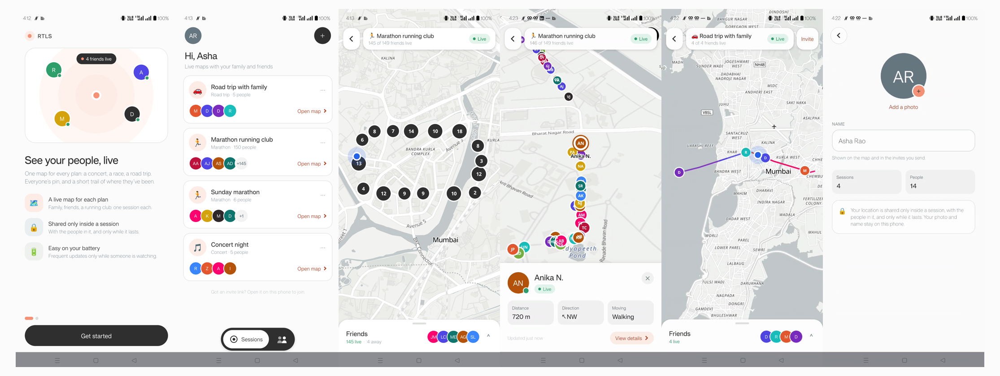
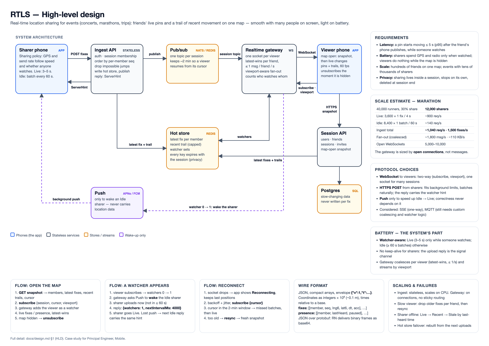
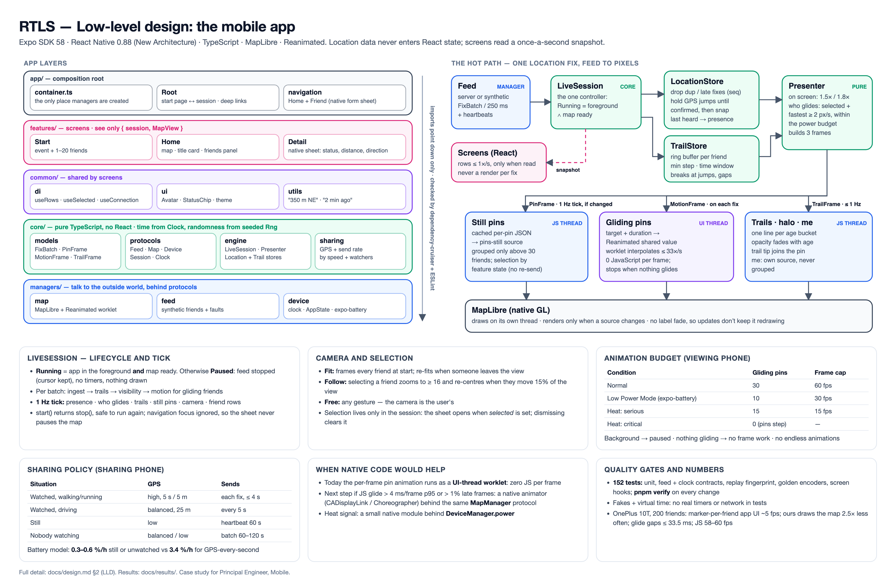

# RTLS — real-time location sharing

See where your friends are at an event — a concert, a marathon, a road trip — as live pins on one map, each with a short trail of where they've been. Built to stay **smooth with many people on screen** and **light on battery**.

A case study for Principal Engineer, Mobile. Expo SDK 58 · React Native 0.88 (New Architecture) · TypeScript · MapLibre · Reanimated worklets.



## Try it

- **Android:** download the APK from [Releases](https://github.com/JitendraLakhmani1824/rtls-app/releases/latest) and open it on the phone (allow installs from this source when asked). Phones (arm64) and x86_64 emulators.
- **Videos:** [Android, OnePlus 10T](docs/media/rtls-demo-android.mp4) (49 s) · [iOS simulator](docs/media/rtls-demo.mp4) (45 s). Both release builds.

What to do: the **Sessions** tab has three sample sessions (family road trip, marathon, concert); open one. The map flies in from the city and frames everyone, with the last 5 minutes of their trails. Tap a friend (pin or list): the camera flies to them and moves with them, tilting to their direction when they run or drive; the sheet shows distance, direction and movement, and **View details** opens their page. **Invite** shares a join link. **+** starts a new session with people from your **Friends** tab. Friends are simulated on the phone, with realistic movement for each event.

| Screen         | What it does                                                                                     |
| -------------- | ------------------------------------------------------------------------------------------------ |
| Sessions (tab) | Your sessions; open one, start one (+), invite or leave (•••)                                    |
| Friends (tab)  | Family and friends, your name for invites, add a person                                          |
| New session    | Event, name, who's coming (pick a whole circle at once)                                          |
| Session map    | Live pins, trails, presence; Back, Invite; friends panel                                         |
| Friend sheet   | Distance, direction, movement; View details                                                      |
| Person         | Live distance, direction, speed, distance covered; sessions you share; start a session with them |
| Join           | Opened by an invite link: "which one are you?", then the map                                     |

Links: `rtls://join/<code>?e=…&t=…&p=…&f=…` (invite) and `rtls://session/<id>` (open a map). There's no server, so the link carries the whole session and its code seeds the simulation: two phones that open one link see the same people and routes (live positions only roughly agree, as each phone runs its own clock).

## The brief, and where each part is answered

| The brief asks for                                | How it's answered                                                                                                                                                                           | Where                                            |
| ------------------------------------------------- | ------------------------------------------------------------------------------------------------------------------------------------------------------------------------------------------- | ------------------------------------------------ |
| Friends' real-time locations on a map             | Live pins from a seeded synthetic feed (concert, marathon, road trip) behind the same `FeedManager` protocol a server feed would use                                                        | `src/managers/feed`, `src/core/engine`           |
| A trail of recent movement                        | Per-friend trail in fixed memory, fading with age, sent on open; breaks at GPS jumps and data gaps instead of drawing straight lines across them                                            | `src/core/engine/trails.ts`                      |
| A **smooth** experience with **many users**       | Still friends update at most once a second; moving friends **glide on the UI thread with zero JavaScript per frame**; location data never enters React state                                | `src/managers/map`, `docs/results/`              |
| Minimise **battery drain**                        | Sharing phone: GPS accuracy and send rate follow speed and whether anyone is watching. Viewing phone: redraws only what changed, pauses in the background, cuts animation in Low Power Mode | `src/core/sharing`, `docs/results/m4-battery.md` |
| Minimise **performance issues**                   | Typed arrays on the hot path, still pins re-encoded only when they change, grouping only for large sessions, a power budget for animation                                                   | `src/core/engine`, `docs/results/m3-map.md`      |
| **Recognise when native optimisation would help** | The per-frame pin animation is the native-shaped part: today a UI-thread worklet; the next step, with its trigger, is a native animator behind the same `MapManager` protocol               | `docs/design.md` §2.8                            |
| Structure for future scalability                  | Pure TypeScript core behind protocols, one composition root, import rules checked on every change; seven screens added without touching the engine's hot path                               | `docs/design.md` §2.1, `docs/import-rules.md`    |
| HLD + LLD                                         | See below, and `docs/design.md`                                                                                                                                                             | `docs/design.md`                                 |
| Code: update the pins on the map                  | Feed → `LiveSession` → map, with presence, trails, GPS faults and a replay test                                                                                                             | `src/`                                           |

## High-level design



- **Sharer phones** upload fixes over HTTPS (background-friendly, batched). The **Ingest API** orders them by per-member sequence, drops impossible jumps, writes the latest fix and trail to a **hot store**, and publishes to a **topic per session**.
- **Viewer phones** fetch a snapshot (members, latest fixes, recent trails, cursor), then subscribe over a **WebSocket**. The **gateway** coalesces per viewer (latest-wins, ≤ 1 message per friend per second) and streams by viewport.
- **Watcher-aware battery:** a sharer goes **Live** (a fix every 3–5 s) only while someone is watching; otherwise it's **Idle** (one batch a minute). The upload reply tells the phone which mode it's in; a push only speeds up the switch.
- **Scale:** a 40,000-runner marathon with 30% sharing is ~1,000 requests/s and ~110 KB/s of fan-out. The gateway is sized by open connections, not messages.
- **Privacy:** sharing exists only inside a session, stops on its own, and every key expires when the session ends.

Full detail — flows, wire format, protocol choices, failures, observability, security: [`docs/design.md` §1](docs/design.md).

## Low-level design (the app)



- **Layers:** `app` (composition root) → `features` (screens) → `common` (hooks, UI, formatting) → `core` (pure TypeScript: models, protocols, engine, sharing policy) ← `managers` (MapLibre, feed, device). Imports point one way only, enforced by dependency-cruiser and ESLint.
- **The hot path:** a `FixBatch` (typed array) goes into `LiveSession` → `LocationStore` (drops duplicates and late fixes, holds GPS jumps until confirmed, tracks last-heard for presence) and `TrailStore` → `Presenter`, which decides who is on screen and who glides, and builds three frames:
  - **PinFrame** — still pins, at most once a second, only if something changed; encoded with a per-pin cache.
  - **MotionFrame** — target + duration for gliding friends; a **Reanimated worklet on the UI thread** interpolates every frame with no JavaScript.
  - **TrailFrame** — trails in four age buckets, faded by opacity.
- **Screens** read a once-a-second snapshot (`useRows`, `useSelected`, `useConnection`) — never a React render per location fix.
- **Lifecycle:** the session runs only while the app is in the foreground and the map is ready; otherwise the feed stops (keeping its cursor) and nothing is drawn.
- **Camera:** a new map flies in and frames everyone; selecting a friend flies to them, then moves with them using the same target and duration as their gliding pin (tilted and turned to their direction when they move fast); any gesture hands the camera to the user. All native animations; calm under Low Power Mode or Reduce Motion.
- **Sessions:** only the session whose map is open runs; the others cost nothing. Sessions and people are saved on the phone behind a `Storage` protocol.
- **Presence:** Live / Recent / Stale from when we last heard (fix or heartbeat), never from movement alone — a friend standing still stays Live.

Full detail: [`docs/design.md` §2](docs/design.md).

## Key decisions

| Decision                                              | Why                                                                                                                    |
| ----------------------------------------------------- | ---------------------------------------------------------------------------------------------------------------------- |
| Still and gliding pins in separate map sources        | Most friends at an event are still: they update ≤ 1×/s; only the few moving visibly animate                            |
| Gliding on the UI thread (Reanimated worklet), not JS | Zero JavaScript per frame; measured in the M0 spike against two alternatives (`docs/results/m0-spike.md`)              |
| Motion frames carry target + duration, not timestamps | The renderer glides on its own clock — no clock mapping between threads; works the same for a future native animator   |
| Typed arrays for fixes and frames                     | No objects per fix; plain numbers cross the boundaries a native module would cross                                     |
| Grouping only above 30 friends                        | A group of friends always sees every friend; grouping keeps large sessions readable                                    |
| Heartbeats for still friends                          | Presence without GPS fixes: a still phone sends "I'm here" once a minute, and at once when it stops                    |
| Watcher-aware sharing                                 | The radio's ~10 s tail after each send makes frequent sends expensive; pay for live updates only while someone watches |
| No label fade on the map                              | MapLibre's fade keeps redrawing after every update                                                                     |

Every decision with its date and trade-off: [`docs/decisions.md`](docs/decisions.md).

## Results (OnePlus 10T, release build)

| What                                                                            | Result                                                                                                                |
| ------------------------------------------------------------------------------- | --------------------------------------------------------------------------------------------------------------------- |
| 200 friends, "one marker view per friend" approach                              | App UI ~5 frames/s, 24–65% janky — fails                                                                              |
| 200 friends, ours: still pins update ≤ 1×/s, moving pins glide on the UI thread | Map draws 19 frames/s (2.5× fewer than a single rebuilt source), JS 60 fps                                            |
| Gliding at street zoom                                                          | Frame gaps p50 16.7 ms, max 33.5 ms — never more than one refresh late                                                |
| Camera following a runner (tilted)                                              | Same frames as with the camera still: 49 vs 48 frames/s, max gap 33.5 ms (`docs/results/m7-camera.md`)                |
| Sharing battery (model)                                                         | 0.3–0.6 %/h standing still or unwatched vs 3.4 %/h for GPS-every-second; 2.1–2.8 %/h while a moving friend is watched |

Method, caveats and raw runs: [`docs/results/`](docs/results/) — including two mistakes in our own measurement that were caught and corrected.

## Run it from source

```bash
pnpm install
pnpm ios                 # iOS simulator (dev build)
pnpm android:release     # Android phone over USB (release build)
pnpm verify              # typecheck, lint, import rules, tests, docs check
```

Scenario links open an unsaved map directly (used for measurement): `rtls://scenario?name=marathon&friends=200&faults=drops,jumps&perf=1`. All parameters: `.claude/skills/run-scenario/SKILL.md`.

## Code tour

```
src/app/           start-up wiring: container.ts (the only place managers are created), Root, navigation, deep links
src/features/      sessions · friends (tabs) · new-session · join · session-map · detail (native sheet) · person
src/common/        di (snapshot hooks) · ui (Avatar, StatTile, ScreenHeader, theme) · utils (formatting) · navigation types
src/core/          pure TypeScript: models → protocols → engine (LiveSession, stores, Presenter, camera) · sessions (book, invites) · sharing (policy)
src/managers/      map (MapLibre + worklet) · feed (synthetic friends + faults) · device (clock, app state, battery) · storage
src/lab/           dev-only: comparison ladder (rungs A–D), PerfRecorder, battery model
src/testing/       fakes, contract tests, replay fingerprint
docs/              prd · design (HLD + LLD) · plan · decisions · results · media
```

## Testing

216 tests, all with fakes and virtual time — no real timers or network:

- **Unit:** store, trails, presence, presenter, budget, camera, sharing policy, session book, invite links, formatting.
- **Contracts:** every `FeedManager`, `Clock` and `Storage` implementation passes the same suite.
- **Replay fingerprint:** seed → 60 virtual seconds with every fault on → a hash of everything sent to the map. If it changes, behaviour changed.
- **Golden tests** for the GeoJSON encoders; **screen hooks** with `renderHook`.

`pnpm verify` runs all of it plus typecheck, lint, import rules and a docs check; a hook runs it before any change is called done.

## How AI was used

Built with Claude Code. The repository is set up so an assistant follows the architecture without being told: `AGENTS.md` and per-folder `CLAUDE.md` cards, path-specific rules, import rules that fail the build with a fix-it message, a hook that runs `pnpm verify` before finishing, and skills to run a scenario on a device and measure it. Every number was measured on the phone, and the decisions log records what changed and why.

## Not built

A real server (and with it accounts and https app links for invites), the sharer's real GPS, measured viewer energy (needs power-rail measurement), and the phone's heat signal (needs a small native module behind `DeviceManager.power`). Low Power Mode and Reduce Motion are wired.
