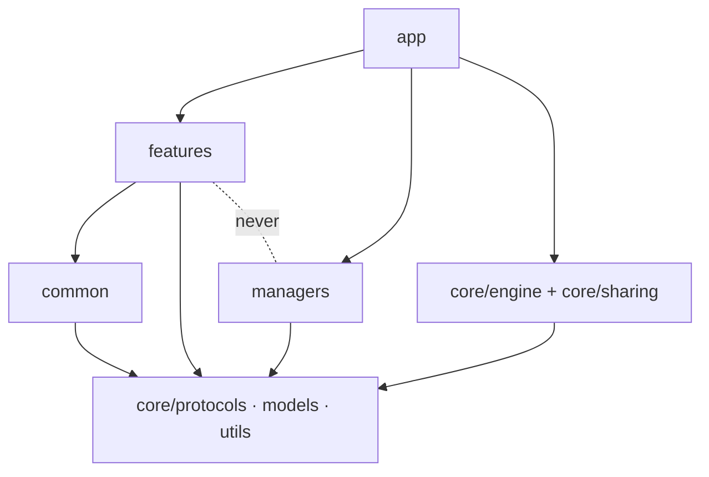
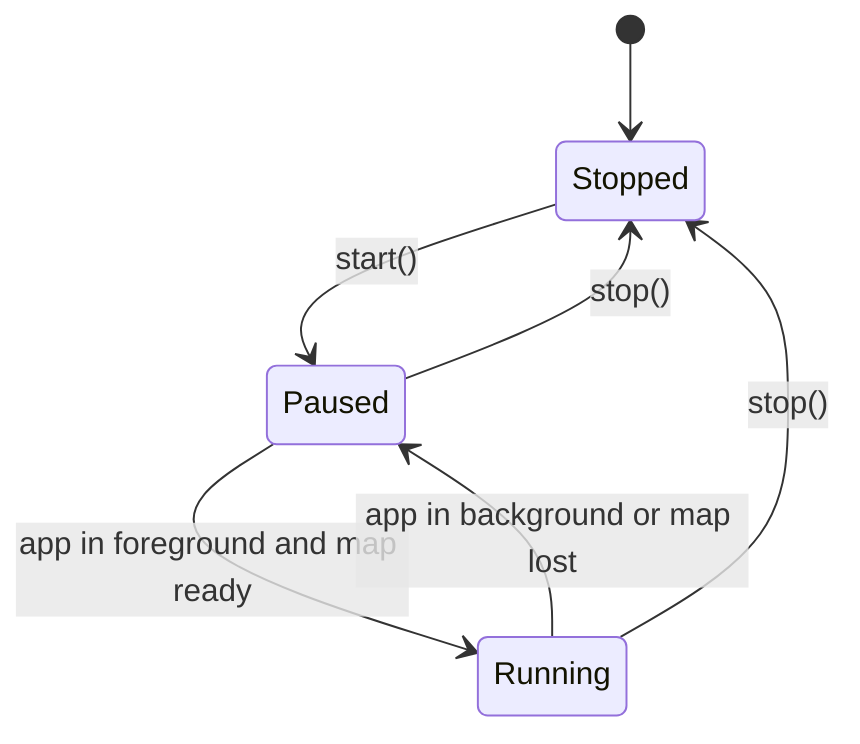

# RTLS — Design (HLD + LLD)

Real-time location sharing for events · Principal Engineer (Mobile) case study · Draft v0.2, 2026-11-26

Status: **LLD drafted; HLD outlined** (written in M1). Numbers marked *target* are not measured yet; §2.10 fills in as milestones land.

---

## Summary

*(Written last: the problem in two lines, the five key decisions, and the headline measured numbers.)*

---

# Part 1 — HLD (outline)

| # | Section | Will cover |
| --- | --- | --- |
| 1.1 | Requirements | Live pins + trails; pin starts moving ≤ 5 s after a publish (p95, Live mode); battery-light; many users per map |
| 1.2 | Scale estimate | Marathon: 40k runners, 30% sharing, 1 fix / 5 s → ~2.4k uploads/s, ~4–5k fan-out msgs/s, < 1 MB/s; gateways are connection-bound |
| 1.3 | Architecture | Diagram: sharer phone → Ingest API (HTTPS) → pub/sub (per-session topics) → Realtime gateway (WebSocket) → viewer phone; hot store (latest + trails, TTL); Postgres (users, sessions); APNs/FCM |
| 1.4 | Key flows | Three sequence diagrams: **open the map** (snapshot, then deltas) · **a watcher appears** (sharer switches Idle → Live) · **reconnect** (resume from cursor, no gaps) |
| 1.5 | Wire format | WebSocket messages (subscribe, snapshot, fix batch, presence, state, session ended) and upload request / reply (`ServerHint`) as tables; protocol version field |
| 1.6 | Protocols | WebSocket for open maps, HTTPS for background uploads, push only to wake; SSE and MQTT considered |
| 1.7 | Battery (system) | Watcher-aware sending; per-viewer coalescing; viewport-aware fan-out |
| 1.8 | Scaling | Gateways scale out; topic per session; hot store with expiry; backpressure |
| 1.9 | Failures | Offline phones, gateway loss, duplicates / reordering, clock skew |
| 1.10 | Observability | Stutter rate, feed lag, upload success, battery per hour by mode — without logging coordinates |
| 1.11 | Security and privacy | Who may join a session, token on the socket, session-scoped sharing, auto-stop, deletion at session end |
| 1.12 | Trade-offs | What we chose, what we gave up, what we'd revisit |

---

# Part 2 — LLD

How the app works inside. Everything here is built, except §2.7's sharing phone (designed, and simulated in code).

## 2.1 Architecture

### Folders

```
src/
├── app/            start-up wiring: container.ts · launch-params.ts · navigation.tsx · Root.tsx
├── features/
│   ├── home/       HomeScreen · useHome           (live map + friend list panel)
│   └── detail/     DetailSheet · useDetail        (one friend, native form sheet)
├── managers/       talk to the outside world, implement core protocols
│   ├── map/        MapLibreManager · MapView · layers · encode
│   ├── feed/       SyntheticFeedManager · scenarios/ · tracks · withFaults
│   └── device/     ExpoDeviceManager: clock · frames · visibility · power
├── common/
│   ├── ui/         theme · Button · Badge · Avatar · Panel · ErrorBoundary
│   ├── utils/      distance / direction / "10 s ago" text
│   ├── di/         ManagersProvider · useManagers() · useRows / useSelected / useConnection
│   └── navigation/ routes.ts (RootStack types)
├── core/
│   ├── utils/      geo · interpolate · ring buffer · seeded Rng
│   ├── models/     Member · Viewport · ConnState · frame layouts
│   ├── protocols/  every interface in §2.2
│   ├── engine/     LiveSession · store · trails · presence · presenter · budget
│   └── sharing/    SharingPolicy · radio model · simulated GPS + uplink
├── lab/            dev only: ladder rungs · PerfRecorder + overlay · battery table
└── testing/        fakes · contract tests · createTestManagers
modules/rtls-thermal/   native heat reader (Swift + Kotlin), used only by managers/device
```

A feature starts as `XScreen` + `useX`. It gains `views/` past ~150 lines and `logic/` only when there is real logic.



### Import rules

Enforced by a dependency-cruiser allow-list; the generated table is `docs/import-rules.md`. In short:

- `features` and `managers` see only `core/protocols`, `core/models`, `core/utils` (plus `common` for features).
- `core/engine` and `core/sharing` are imported only by `app`, `lab` and `testing`.
- MapLibre is imported only in `managers/map`; `expo-battery` and the native module only in `managers/device`.
- No cycles; imports go through each folder's `index.ts`; features never import each other; `core` never imports React, React Native or Expo; no `Date.now()` / `Math.random()` in `core` and `common` (use `Clock` and `Rng`).

### Dependency injection

Pure DI: constructor injection typed as protocols; no container library.

```ts
// app/container.ts — the only file that names implementations
export function createContainer(p: LaunchParams) {
  const device  = new ExpoDeviceManager()
  const feed    = withFaults(new SyntheticFeedManager(p.scenario, device.clock, seededRng(p.seed)), p.faults)
  const map     = new MapLibreManager()
  const perf    = p.perf ? new PerfRecorder(device.clock) : noopPerf
  const session = new LiveSession({ feed, map, device, perf })
  return {
    screens: { session, MapView: map.MapView },   // all that screens ever see
    start: () => session.start(),                 // returns stop(); called from Root's effect
  }
}

// app/Root.tsx
useEffect(() => container.start(), [])           // restartable, so React's dev double-mount is safe
<ManagersProvider value={container.screens}>…</ManagersProvider>
```

`useManagers()` returns `{ session: Session; MapView: ComponentType }` — screens cannot reach the feed, the device or the map manager. Tests build the same shape with `createTestManagers(overrides)`.

## 2.2 Protocols

All in `core/protocols`, only at boundaries — where something is swapped or faked. Internal pieces (store, presenter, budget, trails) are concrete classes tested directly. Only plain numbers and typed arrays cross these boundaries, so a native implementation can read them without conversion.

```ts
type Stop = () => void
interface Readable<T> { get(): T; subscribe(cb: () => void): Stop }

// Time and device
interface Clock          { now(): number; every(ms: number, cb: () => void): Stop; after(ms: number, cb: () => void): Stop }
interface FrameScheduler { start(cb: () => void): Stop }          // screen-refresh ticks; time comes from Clock
type Power = { lowPowerMode: boolean; thermal: 'nominal' | 'fair' | 'serious' | 'critical'; battery: number }
interface DeviceManager  { clock: Clock; frames: FrameScheduler
                           foreground: Readable<boolean>           // app state only — never navigation focus
                           power: Readable<Power> }

// Friend feed
interface FeedManager    { start(sink: FeedSink, resume?: Cursor): FeedHandle }   // never calls sink after stop()
interface FeedSink       { onMembers(m: Member[]): void; onFixes(b: FixBatch): void; onPresence(p: PresenceBatch): void
                           onState(s: ConnState): void; onSessionEnded(): void }
interface FeedHandle     { setViewport(v: Viewport): void; cursor(): Cursor; stop(): void }

// Map
interface MapCamera      { fitBounds(b: Bounds, ms: number): void; centerOn(lng: number, lat: number, ms: number): void }
interface MapManager     { ready: Readable<boolean>; viewport: Readable<Viewport>; camera: MapCamera
                           setMembers(m: Member[]): void; setStill(f: PinFrame): void; setMoving(f: MotionFrame): void
                           setTrails(t: TrailFrame): void; setSelected(id: number | null): void
                           setFrameRateCap(fps: number): void; frame?(nowMs: number): boolean   // false = no glide left
                           onPinPress(cb: (id: number) => void): Stop }

// What screens see of the engine
interface Session        { select(id: number | null): void; setCameraMode(m: CameraMode): void
                           rows: Readable<Row[]>; selected: Readable<Card | null>; connection: Readable<ConnState> }
interface Perf           { time(name: string, ms: number): void; count(name: string): void }

// Sharing phone (design; simulated in core/sharing)
interface LocationSource { configure(c: GpsConfig): void; subscribe(cb: (b: FixBatch) => void): Stop }
interface Uplink         { send(b: FixBatch): Promise<ServerHint> }
type ServerHint = { watchers: number; nextIntervalMs: number; sessionEndsAt: number }
```

**Buffer rule:** senders reuse their typed arrays. A receiver uses or copies the data before returning and never keeps a reference.

## 2.3 Data model

| Type | Shape | Notes |
| --- | --- | --- |
| `Member` | `{ id, key, name, initials, colour, isMe }` | `id` is a dense index 0…N−1 assigned once per session, so per-friend state is array-indexed. `isMe` marks the viewer (the scenario's "me" in the build) |
| `FixBatch` | `{ n, buf: Float64Array }`, 6 per fix | `member, seq, lng, lat, tMs, accuracyM`; `seq` per member, assigned by the server |
| `PresenceBatch` | `{ n, buf }`, 3 per entry | `member, lastHeardMs, paused (0/1)` |
| `PinFrame` | `{ n, buf }`, 4 per pin | `member, lng, lat, presence` (0 live, 1 recent, 2 stale) |
| `MotionFrame` | `{ n, buf }`, 7 per pin | `member, lng0, lat0, t0, lng1, lat1, t1` — a movement segment |
| `TrailFrame` | `{ n, offsets: Uint32Array, coords: Float64Array }` | Per member: points `lng, lat, ageBucket`; `offsets` mark where each member starts |
| `Viewport` | `{ west, south, east, north, zoom, gesturing }` | From map region events |
| `ConnState` | `{ kind: 'live' \| 'reconnecting' \| 'offline', sinceMs }` | Owned by the feed |
| `Cursor` | opaque | Last session-level batch sequence; resumes a feed without gaps |

**One time base:** the feed converts server timestamps to local `Clock` time on arrival (tracking the offset), so everything downstream compares like with like.

## 2.4 Engine (`core/engine`)

### LocationStore

- Per member, preallocated: latest fix (`lng, lat, tMs, accuracy, seq`), previous accepted fix, a pending-jump slot, a `TrailBuffer`.
- **`ingest(batch)`**, O(k) for k fixes, no allocation per fix:
  1. `seq ≤ lastSeq` → drop (duplicate or out of order).
  2. Implied speed from the previous accepted fix above the profile maximum (walk 4 m/s, run 8 m/s, drive 60 m/s) → park as a pending jump. If the next fix lands within 50 m of it, accept the jump and mark it **snap**; otherwise discard it. **Every accepted over-speed fix snaps**, whatever its reported accuracy.
  3. Accuracy > 50 m → update latest (the map shows a halo) but don't extend the trail.
  4. Moved ≥ 5 m since the last trail point → append to the trail.
  5. Mark the member dirty.

### TrailBuffer

- One `Float64Array(capacity × 3)` ring of `lng, lat, tMs`; capacity 256; window 15 min (event profile).
- Race profile: on overflow, thin the oldest half (drop every other point) instead of overwriting.
- On read, a gap > 120 s breaks the line into separate segments.
- No simplification in JS: the `trails` source simplifies per zoom with MapLibre's `tolerance`. Measure before adding anything.

### Presence

Computed on the 1 Hz tick from when a member was last heard from (fix or heartbeat):

| State | Rule |
| --- | --- |
| `Live` | Heard within 2.5× its expected interval (moving: the fix interval; still: the 60 s heartbeat → 150 s) |
| `Recent` | Up to 5 min |
| `Stale` | Over 5 min ("last seen") |
| `Paused` | Flagged by the sharer |

### Presenter (pure calculator, no timers, no subscriptions)

Inputs: store, viewport, selection, budget, `now`. Outputs: what to send to the map, or nothing.

1. **On screen only:** members inside the viewport padded 1.5×; a member leaves only past 1.8× (hysteresis), so pins don't flicker at the edge while panning.
2. **Who glides:**
   - The selected or followed friend always glides.
   - **Below the cluster max zoom** (where clustering can happen), only that friend glides.
   - At street zoom, the rest are ranked by screen speed (ground speed ÷ metres-per-pixel at the current zoom and latitude); the top `K` from the budget with ≥ 2 px/s also glide.
3. **Movement segments:**
   - When a gliding member gets a new fix: a segment from its current drawn position (interpolated at `now`) to the new fix, over the expected update interval (clamped 0.5–5 s).
   - A snap fix gives a zero-length segment.
   - Segments are sent as a `MotionFrame` when fixes arrive, not every frame.
4. **Still pins:**
   - The still frame always holds **every** on-screen still pin, because sources are replace-all.
   - It is sent on the 1 Hz tick only if any pin moved ≥ 1 px or changed presence.
   - Gliding members are **left out** of it, so they're never counted inside a cluster or drawn twice.
5. **Trails:** the selected friend always; everyone on screen when ≤ 30 are visible. Each point carries one of 4 age buckets for fading.

### Animation budget

`budgetFor(power, gesturing)` is a pure function:

| Condition | Gliding pins `K` | Glide frame cap | Still-pin updates | During pan/zoom |
| --- | --- | --- | --- | --- |
| Normal | 30 | 60 fps | 1×/s | source updates 4×/s |
| Low Power Mode | 10 | 30 fps | 1×/s | 2×/s |
| Heat `serious` | 15 | 15 fps | 1×/s | 2×/s |
| Heat `critical` | 0 (all pins step) | — | 1×/s | 1×/s |

### LiveSession (the controller)



- **Ownership.** The only code that starts or stops anything. It owns the store and presenter. `start()` returns `stop()` and can run again, so React's development double-mount is safe.
- **Running = app in the foreground and map ready.** Navigation focus is ignored, so opening the Detail sheet never pauses the map.
- **Entering Running:**
  1. `feed.start(sink, cursor)`.
  2. Subscribe to viewport (**throttled**: first and last event in every 150 ms window) and power.
  3. Re-send everything to the map; it may have been recreated.
  4. Start the 1 Hz tick: presence, still pins, session snapshot.
- **Frame loop.** Runs only while Running, the map has `frame()`, and a glide is unfinished. New fixes, viewport changes and selection wake it; it stops itself when `frame()` reports no glide left.
- **Leaving Running.** Stop the feed (keep its cursor) and the ticks. The store keeps last-known positions.
- **Feed events:**
  - `onFixes` → ingest → segments → `map.setMoving` → wake the frame loop.
  - `onState` → publish `connection` immediately.
  - `onSessionEnded` → stop and show "Session ended".
- **Pin taps.** The session listens to `map.onPinPress` and calls `select(id)`. Screens only react to `selected`.
- **Camera modes:**
  - *Fit* (default) re-fits only when a member leaves the padded bounds.
  - *Follow* re-centres when the friend moves > 10% of the view.
  - *Me* centres once on my position.
  - Any user gesture switches to *Free*.
- **Lazy snapshot.** `rows`, `selected` and `connection` are separate readables. Each is computed on the tick only while something subscribes to it; unchanged parts keep their object identity.

## 2.5 Map (`managers/map`)

- **Style:**
  - OpenFreeMap Positron, bundled as JSON and passed as an object to `mapStyle`, so the map and pin circles load with no network.
  - Initials and cluster counts need glyphs from the network; offline they show as plain circles, which is accepted.
  - All text uses `Noto Sans *`, the only glyphs OpenFreeMap serves.
  - The bundled style pins today's tile URL, so refresh it before sharing builds.
  - `onDidFinishLoadingStyle` sets `ready`; unmount clears it.
- **Four GeoJSON sources**, split by how often they change:

| Source | Contents | Updated | Notes |
| --- | --- | --- | --- |
| `pins-still` | Every on-screen still pin | ≤ 1×/s, only when something changed | `cluster: true`; points only (clustering rejects lines); feature `id` = member id |
| `pins-moving` | ≤ `K` gliding pins | Every frame while gliding | Never clustered |
| `trails` | Trail lines | When a fix arrives | `tolerance` simplifies per zoom; `line-opacity` driven by age bucket (`line-gradient` can't vary per feature) |
| `trail-tip` | Selected friend: last trail point → current glide position | Every frame while gliding | Keeps the trail attached to the moving pin |

- **Layers:**
  - cluster circle + count;
  - pin circle in the member's colour, plus initials;
  - accuracy halo;
  - selection ring via feature state (paint only).

  Symbol layers set `icon-allow-overlap`, `icon-ignore-placement` and `text-allow-overlap`, so updates don't re-run label placement and fades.
- **`frame(now)`:** interpolates every active segment into a reused buffer, encodes, updates `pins-moving` and `trail-tip`.
- **`encode.ts`** (pure): typed arrays → GeoJSON string with a reused string builder. It rejects `NaN` / `Infinity`, because one bad number blanks the whole layer. Golden-file tested.
- **Update path** into `GeoJSONSource.data` (decided in M0, see `docs/results/m0-spike.md`):
  - **Every-frame sources** (`pins-moving`, `trail-tip`): **Reanimated animated props from a UI-thread worklet** that interpolates the movement segments. Full 30 updates/s with zero JavaScript time on the OnePlus 10T.
  - **Once-a-second sources** (`pins-still`, `trails`): a prop on a small leaf component.
  - **Fallback:** `getAnimatableRef().setNativeProps({ data })`, about 4 ms of JS per update.
  - **Still to check:** a real iPhone, where source parsing and the worklet share the main thread.
- **Frame cap:** `preferredFramesPerSecond` from the budget.
- **Viewport:** `onRegionIsChanging` / `onRegionDidChange` feed a plain emitter, never React state.
- **Platform difference:** Android parses source data off the main thread and keeps only the latest; iOS parses on the main thread. Per-frame payloads stay small (≤ ~30 features, a few KB).

## 2.6 Screens

- **Shape:** `XScreen` wires `useX()` to views. `useX` is the only file that uses `useManagers()` and navigation, and returns data + actions. Function components only; the one class is `ErrorBoundary`.
- **Snapshot hooks:** `useRows()`, `useSelected()`, `useConnection()` — `useSyncExternalStore` over the session's readables. Nothing subscribes to per-frame data. The friend list mounts only when the panel is expanded, so collapsed means `rows` is never computed.
- **Text:** the snapshot carries distance and bearing from me, and age, as numbers; rows arrive sorted by distance. `common/utils` formats "350 m NE" and "updated 10 s ago".
- **Home:** full-screen `MapView`, friend list panel (fixed-height rows), camera buttons, connection badge. Tapping a row calls `session.select(id)`. When `selected` becomes non-null, `useHome` navigates to `Friend`.
- **Detail:** React Navigation native-stack screen `Friend`:
  - `presentation: 'formSheet'`;
  - at most three fixed `sheetAllowedDetents`;
  - `sheetLargestUndimmedDetentIndex` set, so the map stays undimmed and touchable;
  - `contentStyle.backgroundColor` set.

  It shows status, last seen, distance + direction, and a Follow button. `useDetail` closes the sheet when `selected` becomes null; dismissing the sheet calls `session.select(null)`. The route has no params: selection lives only in the session. `enableFreeze()` is never called, so the map keeps drawing under the sheet.
- **Fallback:** if the M0 sheet check fails on Android, the detail card renders inside Home's panel.
- **Launch parameters:** `app/launch-params.ts` reads a deep link (`rtls://scenario?name=marathon&friends=500&hz=1&seed=42&rung=D&faults=drops,jumps`) or the dev scenario picker and builds the container from it. The ladder rung is fixed at launch, so production code never checks it.
- **Layout:** portrait only. Layout reads window size, never screen size.

## 2.7 Battery on the phone

### Viewing phone (built, measured)

- App in the background → Paused: no feed, no ticks, no frames.
- Nothing gliding → no frame loop. No perpetual animations (no pulsing rings, no heading puck).
- Speed-based glide budget and frame cap (§2.4); smaller budget under Low Power Mode or heat.
- Camera modes with hysteresis, so fit and follow don't animate continuously.
- The friend list is only computed while it's on screen.

### Sharing phone (designed; simulated in `core/sharing`)

`SharingPolicy` is a pure `(state, event) → decision`. The movement class comes from GPS speed, so no motion-sensor permission is needed: still < 0.5 m/s · walk < 2.5 · run < 7 · drive ≥ 7.

| Situation | GPS | Sends |
| --- | --- | --- |
| Live (watched), walking or running | High accuracy, 5 s / 5 m | Each fix, every 3–5 s |
| Live, driving | Balanced, 5 s / 25 m | Every 5 s |
| Live, still | Low accuracy, 30 s | Heartbeat every 60 s |
| Idle (nobody watching), moving | Balanced, 15 s / 20 m | Batch every 60 s |
| Idle, still | Low accuracy, 60 s | Heartbeat every 120 s |
| Battery < 20% or Low Power Mode | One level lower | At least every 60 s, unless Live |

- **Why these intervals:**
  - after each send the radio stays awake ~10 s, so batching only saves energy beyond ~30–60 s;
  - a 60 s heartbeat keeps a still friend's radio idle most of the time;
  - Live mode accepts the radio cost to meet the latency target, defined as **the pin starts moving within 5 s** of a publish.
- **Watcher signal:** every upload's `ServerHint` carries `watchers`, `nextIntervalMs` and `sessionEndsAt`. Push only speeds up the switch to Live; in the worst case the switch waits one Idle interval.
- **iOS ("While Using"):** GPS can't be stopped while still and restarted in the background, so it stays on at low accuracy with `pausesLocationUpdatesAutomatically = false`. iOS 17+: `CLLocationUpdate.liveUpdates` + `CLBackgroundActivitySession`.
- **Android:**
  - foreground service of type `location`, started while visible (`FOREGROUND_SERVICE_LOCATION` + notification permission);
  - batching via `setMaxUpdateDelayMillis`;
  - if the system or the phone maker's battery manager kills the service, the server notices the missing heartbeat and pushes "sharing stopped".
- **Battery model:** `lab/battery` runs `SharingPolicy` with simulated GPS and a simulated radio over the scenario tracks. Output per scenario and mode: fixes/h, uploads/h, radio-awake s/h, estimated mAh. The constants and their sources are listed with the table; it is a model, not a measurement.

## 2.8 Native code

| Hot spot | Now (JS / Expo) | Native iOS | Native Android | Switch when | Cost |
| --- | --- | --- | --- | --- | --- |
| Background location (design) | `expo-location` background task — GPS already native, JS woken per batch | `CLLocationUpdate.liveUpdates` + `CLBackgroundActivitySession` | Foreground service + `FusedLocationProviderClient`, `setMaxUpdateDelayMillis` | Policy must change GPS settings while JS isn't running; JS wake > ~150 ms CPU per batch; > 1% batches missed in a 1-h walk | Two codebases in the most failure-prone area |
| Upload scheduling (design) | `fetch` in that task | `URLSession` + `waitsForConnectivity` | OkHttp in the service; `WorkManager` retries | Batches lost when JS is killed | Durable queue, written twice |
| Pin animation | `MapLibreManager.frame()` over ≤ `K` segments; worklet as the middle step | `CADisplayLink` animator setting the shape; later a custom style layer | `Choreographer` + worker calling `setGeoJson`; later a custom layer | JS glide p95 > 4 ms/frame or > 1% stuttering map frames | Custom layer loses clustering, taps, style rules |
| Map data hand-off | JSON string → prop → native parses | Module takes an `ArrayBuffer`, builds point features | Same via `FeatureCollection.fromFeatures` | Encode + parse > 30% of update time, or > 2 ms per update on iOS main thread | Reaches into MapLibre RN internals |
| Realtime decode (design) | RN `WebSocket`, compact JSON text (binary arrives as base64) | `URLSessionWebSocketTask`, native decode | OkHttp `WebSocket` | > ~500 updates/s or feed > 20% of JS thread | Reconnect logic moves native |
| Heat signal | Not in Expo | `ProcessInfo.thermalState` | `PowerManager.getCurrentThermalStatus` | Now | ~50 lines |

**Built as proof if time allows (P2):** `modules/rtls-thermal`, a local Expo Module returning `nominal | fair | serious | critical` plus change events. It sits behind `DeviceManager.power`, and `budgetFor()` decides what heat means. A JS stub implements the same protocol, so a build problem can't block the app.

## 2.9 Testing

| Layer | What | Tooling |
| --- | --- | --- |
| Unit | Store, trails, presence, presenter, budget, `SharingPolicy`, geo / interpolate | Jest, plain TypeScript |
| Golden | `encode.ts` output for fixed inputs | Saved expected files |
| Contract | Feed, session, clock: the real class and its fake pass the same tests (e.g. per-member order, nothing after `stop()`, resume from cursor) | `testing/contracts/*` |
| Lifecycle | Background / foreground, map lost / ready, start → stop → start → feed stopped, cursor kept, everything re-sent | Fake device and map |
| Replay | Seed 42 → 60 virtual seconds → the fingerprint of everything sent to the map matches the saved one | Fake clock, manual frames |
| Screen hooks | `useHome`, `useDetail` with `createTestManagers()` and a stub navigation object | `renderHook` |
| Device | `run-scenario` screenshots; the measurement runs | Release build, Android phone |

## 2.10 Performance results

*Filled in at M3–M6. Release build, Android phone (model named), overlay off, ABAB order, 3 runs each.*

| Rung | What it is | 200 friends (concert) | 1,000 (concert) |
| --- | --- | --- | --- |
| A | One `Marker` per friend, friends in React state | — | — |
| B | One source, updates applied as they arrive | — | — |
| C | + per-frame batching, on-screen only | — | — |
| D | + four sources, segments, speed budget | — | — |

Plus: rung D at 50 and 500 (concert) and at 200 and 1,000 (marathon); and an **energy step** — glide at 30 vs 60 fps, rung D, 500 friends.

Metrics per cell: map frame time p95 and stutter %, JS busy %, main-thread ms per source update, Hermes GC count. Also reported: the crossover point ("below N friends, markers are fine") and the step that didn't help.

*Targets:*
- map frame time p95 ≤ 16.7 ms and < 1% stutter at 500 friends (~50 visible);
- JS ≤ 4 ms per frame p95;
- presenter ≤ 1 ms for 1,000 members;
- 0 React renders per location update;
- flat memory over 30 min (~6 KB of trail per friend → ~6 MB at 1,000).

## 2.11 Edge cases

| Case | Handled by |
| --- | --- |
| Duplicate / out-of-order fixes | Store drops `seq ≤ lastSeq` |
| GPS jump | Pending-jump check; every accepted over-speed fix snaps |
| Poor accuracy | Halo; not added to trail |
| Standing still | 60 s heartbeat; Live for 2.5× that |
| Data gap | Trail breaks at gaps > 120 s |
| Many friends at one spot | Clustering on `pins-still`; tap zooms in |
| Offline start | Bundled style; pins as circles; last-known positions from the store |
| Flaky network | Feed reconnects with backoff + jitter, resumes from cursor; `connection` shown |
| App in background | Session Paused: nothing received or drawn |
| Detail sheet open | Session stays Running; map undimmed and drawing |
| Map recreated | `ready` cycles; session re-sends everything |
| Session ends | `onSessionEnded` → pins fade, "Session ended" |
| Selected friend leaves | `selected` becomes null → sheet closes; follow exits |
| Bad number in a frame | `encode.ts` rejects it; frame dropped and counted |

## 2.12 Future

- **Real server:** `WebSocketFeedManager` implements `FeedManager`, passes the feed contract tests, one line in `container.ts`.
- **Native animation or hand-off:** a new `MapManager` implementation; triggers in §2.8.
- **Sharing my location:** real `LocationSource` + `Uplink` under the same `SharingPolicy`.
- **More features:** new `features/*` folders that see only `common` and core's protocols, models and utils.
- **Bigger team:** each top-level folder becomes a workspace package; the allow-list becomes `package.json` dependencies.
